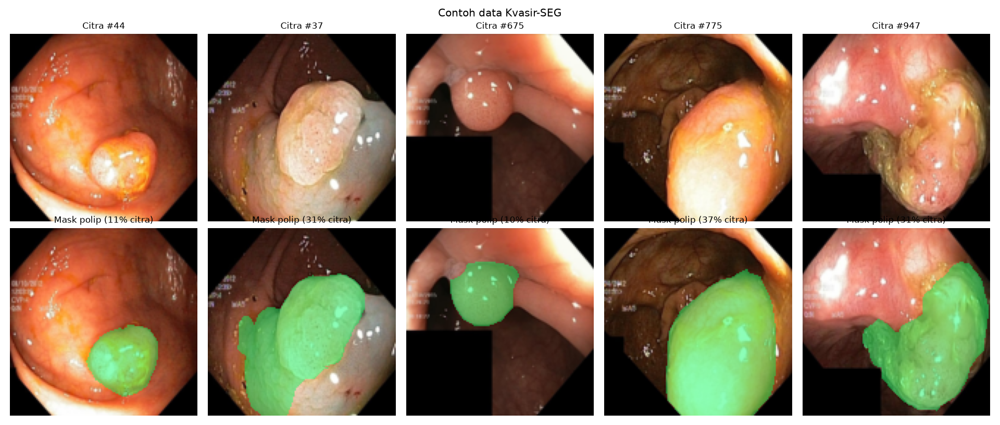
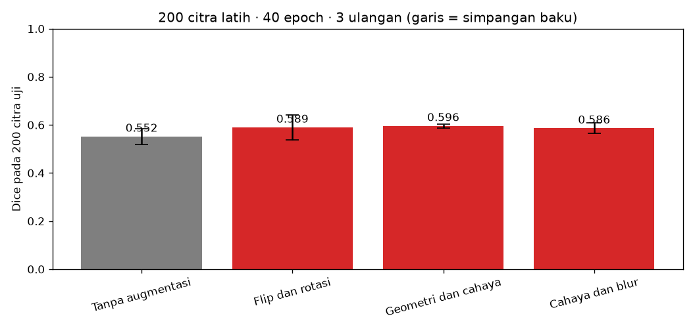
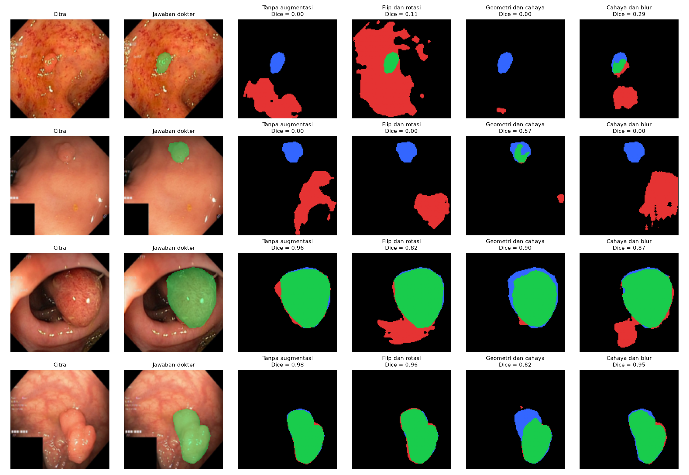

# Segmentasi Polip pada Citra Kolonoskopi dengan U-Net

<!--
  TEMPLATE LAPORAN — Tugas P10 Kecerdasan Buatan (BM25-41204), Teknik Biomedis ITERA.
  Petunjuk lengkap: https://mctm.web.id/ai-bm/tugas

  Cara memakai:
  - Ganti semua teks yang diawali "✍️" dengan tulisan kelompokmu, lalu hapus tanda ✍️-nya.
  - Blok komentar seperti ini adalah petunjuk; tidak tampil di GitHub. Boleh dihapus.
  - Gambar diambil dari folder hasil/ yang dibuat otomatis oleh notebook.
  - Jangan hapus judul-judul bagian (##).
-->

**Tugas P10 — Kecerdasan Buatan (BM25-41204), Teknik Biomedis ITERA**

## Anggota kelompok

| Nama | NIM | Username GitHub | Kontribusi utama |
|---|---|---|---|
| Hafidzah Naura Hesa | 123430012 | HafidzahNauraHesa-012 | Mengimplementasikan rancangan eksperimen kedalam skenario dan menjalankan eksperimen tersebut |
| Hafiza Diva Pratiwi | 123430026 | hafizadiva276-png | ✍️ |
| Okta Yuriko S. | 123430042 | Okta Yuriko A. L Br Simanullang | ✍️ |

## 1. Pertanyaan

Augmentasi apa yang membantu U-Net menemukan polip pada citra kolonoskopi, dan augmentasi apa yang tidak? Kenapa?
Dalam percobaan ini augmentasi geometri dan cahaya paling membantu U-Net dengan nilai Dice nya 0,596 karena adanya variasi posisi, ukuran, kecerahan dan kontras yang membuat model jadi terbiasa mengenali polip pada kondisi yang berbeda. Flip dan rotasi juga membantu dengan Dice nya 0,589. Tapi untuk cahaya dan blur memberikan peningkatan paling kecil dengan Dice nya 0,586. Jadi tidak ada augmentasi yang menghasilkan nilai lebih rendah daripada model tanpa augmentasi , tapi penambahan blur membuat batas polip lebih sulit dikenali

## 2. Data & pengaturan

<!-- Isi dari Bagian 2 notebook. Pastikan CEPAT = False untuk hasil akhir. -->

- Dataset: Kvasir-SEG yang terdiri dari 1000 citra kolonoskopi dan mask polip, dengan ukuran 128 × 128 piksel.
- Data uji: 200 citra  yang digunakan sama pada setiap skenario. Data latih: 800 citra dan dari kumpulan ini dipilih 200 citra untuk setiap ulangan.
- Model: U-Net mini. Pelatihan 40 epoch per skenario dengan 3 kali ulangan untuk setiap skenario
- Dijalankan di: GPU NVIDIA dengan CUDA, PhyTorch dan Jupyter Notebook.



## 3. Skenario augmentasi & hipotesis

<!-- Tulis bagian ini SEBELUM menjalankan eksperimen. Commit dulu, baru jalankan.
     Alasan klinis = kenapa variasi ini mungkin (atau tidak mungkin) terjadi pada kolonoskopi sungguhan. -->

| Skenario | Augmentasi (kode) | Alasan klinis | Hipotesis: Dice naik/turun/sama? |
|---|---|---|---|
| Tanpa augmentasi | — | Pembanding | — |
| Flip dan rotasi  | Flip horizontal, flip vertikal, dan rotasi| Menguji perubahan arah dan posisi citra untuk membantu model mengenali polip dari berbagai arah| Naik |
| Geometri dan cahaya | Flip, pergeseran, perubahan skala, kecerahan, dan kontras| Menguji pengaruh perubahan posisi, ukuran dan pencahayaan | Naik |
| Cahaya dan blur | Perubahan kecerahan, kontras, dan Gaussian blur | Menguji variasi pencahayaan dan ketajaman citra dalam membantu model | Sama |

Contoh augmentasi yang dicoba:


<!-- Ganti nama file sesuai skenario kalian (lihat isi folder hasil/). -->

## 4. Hasil

<!-- Tempel isi hasil/ringkasan.md di sini. -->

| Skenario | Dice (rata-rata ± sb) | IoU (rata-rata ± sb) | Dice tiap ulangan |
|---|---|---|---|
| Tanpa augmentasi | 0.552 ± 0.033 | 0.437 ± 0.029 | 0.508, 0.586, 0.562 |
| Flip dan rotasi | 0.589 ± 0.052 | 0.474 ± 0.045 | 0.593, 0.651, 0.524 |
| Geometri dan cahaya | 0.596 ± 0.008 | 0.476 ± 0.011 | 0.603, 0.584, 0.601 |
| Cahaya dan blur | 0.586 ± 0.022 | 0.464 ± 0.027 | 0.576, 0.565, 0.616 |



## 5. Analisis peta kesalahan



<!-- Hijau = benar, merah = false positive, biru = false negative.
     Pertanyaan pemandu: Polip seperti apa yang sering terlewat (kecil? datar? warna mirip dinding usus?)
     Apa yang sering dikira polip padahal bukan? Apakah augmentasi memperbaiki kasus sulit? -->

✍️

## 6. Pembahasan & kesimpulan

<!-- Bandingkan hasil dengan hipotesis di Bagian 3. Hipotesis yang ternyata salah tetap bernilai,
     asalkan dijelaskan kenapa. Perbedaan kecil (lebih kecil dari simpangan baku) belum tentu berarti. -->

✍️

## 7. Pembagian kerja

<!-- Siapa mengerjakan apa. Penilaian proses kerja dilihat dari riwayat commit tiap anggota. -->

✍️

## 8. Penggunaan AI

<!-- Wajib diisi, walau tidak memakai AI (tulis "Tidak memakai AI").
     Contoh: "Claude Code (CLI) untuk menulis skenario augmentasi dan memperbaiki error di Bagian 4.
     Draf Bagian 6 ditulis sendiri, lalu dirapikan bahasanya dengan bantuan AI." -->

✍️

## Cara menjalankan ulang

Di Windows, pasang `uv` jika belum ada:

```powershell
winget install --id=astral-sh.uv -e
```

Buka ulang terminal, lalu jalankan dari folder repo:

```powershell
uv sync
uv run python -m ipykernel install --user --name tugas-p10-segmentasi-polip --display-name "Python (uv: segmentasi polip)"
```

Di VS Code, buka `segmentasi_polip.ipynb`, klik **Select Kernel** di kanan atas, lalu pilih **Python (uv: segmentasi polip)**. Jika memakai JupyterLab, jalankan:

```powershell
uv run jupyter lab segmentasi_polip.ipynb
```

Pilih kernel **Python (uv: segmentasi polip)** di notebook jika diminta. Kernel tersebut memakai environment `.venv` yang dibuat oleh `uv sync`.

Atau buka notebook di Google Colab (Runtime → Change runtime type → T4 GPU).

## Referensi

- Jha, D., dkk. (2020). Kvasir-SEG: A Segmented Polyp Dataset. *MultiMedia Modeling (MMM 2020)*, 451–462.
- Ronneberger, O., Fischer, P., & Brox, T. (2015). U-Net: Convolutional Networks for Biomedical Image Segmentation. *MICCAI*. arXiv:1505.04597.
- ✍️ tambahkan referensi lain yang kalian pakai
